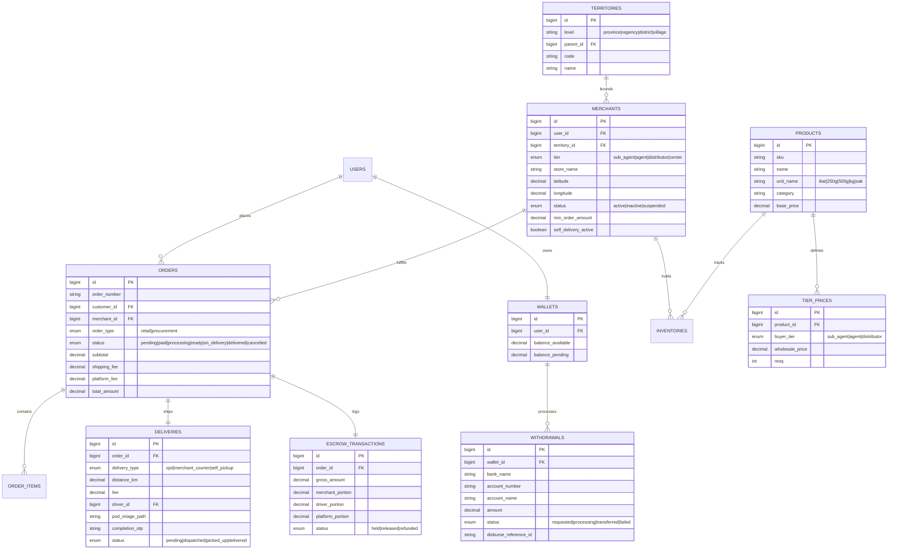

# Product Requirement Document (PRD)
## Mak Ethek – Platform Perdagangan Berjenjang Berbasis Koperasi

* **Versi Dokumen:** 2.0.0 (Pragmatic & Production-Ready Revision)
* **Status:** Approved Architecture
* **Target Stack:** Laravel 11 (PHP 8.2+), Livewire 3 + Alpine.js, Workbox PWA, Bootstrap Mobile-First (Pola Groseri), MySQL/PostgreSQL, Leaflet / OpenStreetMap.
* **Wilayah Target Pilot:** Jawa Timur (1 Kabupaten Pilot).

---

## 1. Ringkasan Eksekutif & Prinsip Desain

Mak Ethek adalah platform perdagangan kebutuhan harian berjenjang (*hyper-local multi-tier commerce*) yang mengonsolidasikan jaringan Koperasi Jawa Timur dari level provinsi sampai warung kelontong desa ke dalam satu ekosistem digital.

### Prinsip Utama Operasional & Arsitektur
1. **Layanan Retail Berjenjang (Desa $\rightarrow$ Kecamatan Fallback):** Konsumen selalu diprioritaskan dilayani oleh Sub-Agen (desa/kelurahan). Jika tidak ada penjual aktif/stok, pesanan otomatis dialihkan (*cascading fallback*) ke Agen di level kecamatan.
2. **Koperasi sebagai Financial Holding:** Menghindari hambatan KYC perbankan pada warung mikro desa dengan menjadikan Koperasi Berbadan Hukum sebagai pemilik akun payment gateway utama. Sistem mencatat hak bagi hasil secara otomatis via *internal double-entry wallet ledger* dan pencairan dana massal (*batch disbursement*).
3. **Logistik Desa yang Realistis:** Mengganti pelacakan live GPS socket (yang boros baterai dan rawan gangguan sinyal) dengan *Milestone Status Engine*, integrasi tautan WhatsApp instan, serta verifikasi serah-terima foto POD (*Proof of Delivery*) / OTP.
4. **Performa Reaktif Tanpa Build Chain Berat:** Menggunakan Laravel 11 + Livewire 3 + Alpine.js dengan template Bootstrap mobile grocery (*Groseri*), menghasilkan interaktivitas secepat SPA tanpa overhead arsitektur frontend terpisah.

---

## 2. Stakeholder & Matriks Peran

| Peran | Entitas Fisik | Wilayah Operasional | Tanggung Jawab Utama |
|---|---|---|---|
| **Customer** | Warga / Rumah Tangga | Desa/Kelurahan | Belanja retail harian, pilih metode antar, verifikasi pesanan selesai via POD/OTP. |
| **Sub Agen** | Warung kelontong, pedagang harian | Desa/Kelurahan | Titik retail utama warga, pemenuhan barang, kulakan rutin ke Agen kecamatan. |
| **Agen** | Koperasi Primer / Unit Usaha | Kecamatan | Penyedia kulakan Sub Agen, melayani pesanan customer jika Sub Agen desa kosong/tutup. |
| **Distributor** | Koperasi Kabupaten / Pusat Logistik | Kabupaten/Kota | Penyedia kulakan Agen kecamatan, fallback tingkat 3 bila Agen tidak tersedia. |
| **Pusat** | Persatuan Koperasi Jawa Timur | Provinsi Jawa Timur | Master katalog produk, standarisasi acuan harga, pemilik rekening gateway & legalitas. |
| **Kurir Lokal** | Driver desa / Ojek pangkalan binaan | Radius operasional | Penjemputan dan pengantaran order, upload foto bukti serah-terima (POD). |
| **Admin Pusat** | Tim Manajemen Koperasi | Backoffice | Verifikasi mitra, audit saldo dompet, monitoring disbursement, master wilayah. |

---

## 3. Spesifikasi Fungsional

### Modul 1: Mesin Hirarki Wilayah & Cascading Fallback Toko
* **Struktur Hirarki Wilayah:**
  $$\text{Provinsi} \rightarrow \text{Kabupaten/Kota} \rightarrow \text{Kecamatan} \rightarrow \text{Kelurahan/Desa}$$
* **Logika Pemilihan Toko Saat Belanja:**
  1. Konsumen menentukan alamat / memilih desa (contoh: *Kelurahan Gedog*).
  2. Sistem mencari mitra penjual aktif bertipe **Sub Agen** di kelurahan tersebut.
  3. **Evaluasi 5 Syarat Ketersediaan Toko:**
     * *Coverage:* Alamat customer masuk radius operasional toko.
     * *Status Buka:* Toko berstatus `online` / aktif menerima pesanan.
     * *Stok Valid:* Semua item dalam keranjang terpenuhi kuantitasnya.
     * *Minimum Belanja:* Memenuhi syarat minimal nilai pesanan toko (jika ada).
     * *Kesiapan Logistik:* Terdapat opsi pengiriman aktif.
  4. **Cascading Fallback Pipeline:**
     * Jika di Kelurahan Gedog tidak ada Sub Agen yang memenuhi syarat $\rightarrow$ sistem otomatis menaikkan query pencarian ke **Agen di tingkat Kecamatan Sananwetan**.
     * Jika Agen Sananwetan juga tidak tersedia $\rightarrow$ dialihkan ke **Distributor tingkat Kabupaten/Kota Blitar**.
  5. Penjual tingkat Desa (*Sub Agen*) dan Kecamatan (*Agen*) diperlakukan sebagai entitas berbeda dengan katalog, harga eceran, dan kapasitas stok masing-masing.

### Modul 2: Customer Storefront & PWA Experience (Pola Groseri)
* **Frontend Tech:** Laravel Livewire 3 + Alpine.js + Bootstrap Mobile.
* **PWA Offline Strategy:** Workbox Service Worker dengan strategi caching *Stale-While-Revalidate* untuk aset antarmuka dan *Network-First* untuk transaksi data belanja.
* **Fitur Utama Belanja:**
  * **Header Lokasi:** Menampilkan desa/kecamatan aktif dengan modal pemilih lokasi cepat.
  * **Katalog Satuan Tradisional:** Mendukung satuan belanja lokal Indonesia (*ikat*, *250 gram*, *500 gram*, *kg*, *sak*).
  * **Single-Merchant Cart Enforcement:** Keranjang belanja hanya menampung barang dari 1 toko untuk menjaga kesederhanaan kalkulasi ongkir dan kepastian serah-terima kurir.
  * **Interaktivitas Keranjang:** Tambah/kurang item dan update subtotal seketika via Livewire 3 tanpa reload browser.

### Modul 3: Logistik & Kalkulasi Ongkir Lokal
* **Pilihan Pengiriman di Checkout:**
  1. **Kurir Ojol Lokal:** Pengantaran via mitra kurir motor lokal.
  2. **Diantar Warung Sendiri:** Tarif fleksibel/flat yang diatur langsung oleh mitra pedagang.
  3. **Ambil Sendiri (Self-Pickup):** Bebas ongkir, customer mengambil belanjaan langsung di warung.
* **Formula Perhitungan Jarak & Tarif (Bebas Biaya API Pihak Ketiga):**
  * Jarak dihitung menggunakan formula trigonometri **Haversine** antara koordinat toko ($\text{lat}_1, \text{lon}_1$) dan koordinat customer ($\text{lat}_2, \text{lon}_2$), dengan faktor koreksi rute darat pedesaan ($1.3\times$).
  $$\text{Jarak Rute (km)} = \text{Haversine}(\text{Toko}, \text{Customer}) \times 1.3$$
  $$\text{Ongkir Ojol} = \text{Rp6.000} + (\max(1, \lceil \text{Jarak Rute} \rceil) - 1) \times \text{Rp2.000}$$
* **Sistem Pelacakan Milestone (Bukan Live GPS):**
  * Status pesanan: `Menunggu Konfirmasi` $\rightarrow$ `Sedang Dikemas` $\rightarrow$ `Kurir Ditugaskan` $\rightarrow$ `Dalam Perjalanan` $\rightarrow$ `Tiba di Lokasi / Selesai`.
  * Integrasi tombol aksi: **Tautan Langsung WhatsApp Kurir & Warung** dengan template pesan order otomatis.
  * Validasi Penyelesaian: Kurir mengunggah foto bukti serah-terima (POD) atau menginput kode 4-digit OTP yang diberikan pelanggan.

### Modul 4: Kulakan Berjenjang (B2B Procurement)
* **Aturan Kunci Pasokan Wilayah:**
  * Sub Agen (Desa) **terkunci hanya bisa kulakan** ke Agen (Kecamatannya).
  * Agen (Kecamatan) **terkunci hanya bisa kulakan** ke Distributor (Kabupatennya).
  * Distributor (Kabupaten) **kulakan ke Pusat** (Persatuan Koperasi Jatim).
* **Mekanisme Grosir:**
  * Tabel harga bertingkat (*Tier Wholesale Pricing*) dan kuantitas minimum pembelian (*MOQ*) per jenjang.
  * Penambahan stok eceran otomatis pada inventori mitra setelah pesanan kulakan diverifikasi diterima.
  * Peringatan stok menipis (*low-stock threshold*) di dashboard mitra untuk segera melakukan order kulakan.

### Modul 5: Sistem Finansial (Holding Escrow, Ledger, & Disbursement)
* **Model Koperasi Holding Gateway:**
  * Akun Payment Gateway (QRIS, Virtual Account BRI/BNI/Mandiri/BCA, E-Wallet) didaftarkan secara legal atas nama **Persatuan Koperasi Jawa Timur**.
  * Warung/mitra desa tidak dibebani kewajiban KYC perbankan bisnis.
* **Internal Double-Entry Ledger di Laravel:**
  * Begitu pembayaran terkonfirmasi via webhook payment gateway, dana tercatat sebagai `escrow_pending`.
  * Setelah pesanan berstatus `delivered` (diverifikasi via POD/OTP):
    $$\text{Total Bayar} = \text{Kredit Dompet Penjual} + \text{Kredit Dompet Driver} + \text{Fee Platform Koperasi}$$
* **Siklus Dompet Mitra (`wallets`):**
  * `balance_pending` $\rightarrow$ `balance_available`.
* **Pencairan Dana (Withdrawal):**
  * Mitra mengajukan penarikan saldo dari dashboard toko.
  * Eksekusi transfer otomatis menggunakan integrasi **Disbursement API** (Flip for Business / Xendit Disburse / Midtrans Iris) langsung ke nomor rekening bank/e-wallet pribadi pemilik warung secara terjadwal.

---

## 4. Desain Struktur Data (Laravel Database Schema)

---

## 5. Kebutuhan Non-Fungsional (NFR)

1. **Efisiensi Jaringan & Aksesibilitas Pedesaan:**
   * Bobot muatan awal halaman (*First Contentful Paint*) di bawah 1.5 detik pada jaringan seluler 3G/4G.
   * Service Worker meng-cache seluruh shell aplikasi (Bootstrap CSS, icons, Alpine.js, Livewire assets) secara lokal.
2. **Keamanan & Verifikasi Transaksi:**
   * Webhook payment gateway dan disbursement API wajib menerapkan *signature verification* dan *idempotency check* untuk menghindari duplikasi saldo.
   * Role-based Access Control (RBAC) ketat berbasis teritori memastikan Agen/Sub-Agen hanya dapat mengakses data wilayah kerjanya.
3. **Integritas Keuangan (Double-Entry Balance):**
   * Setiap mutasi saldo di tabel `wallets` wajib memiliki catatan koresponden di tabel log transaksi (`wallet_mutations`). Saldo tidak boleh diedit secara arbitrer.

---

## 6. Rencana Pelaksanaan MVP (12 Minggu)

| Fase | Durasi | Sasaran & Deliverable Utama |
|---|---|---|
| **Fase 1: Discovery & Fondasi** | Minggu 1–2 | Finalisasi skema database wilayah, setup Laravel 11 + Livewire 3 + Workbox PWA, implementasi template Bootstrap Groseri. |
| **Fase 2: Core Storefront & Routing Wilayah** | Minggu 3–5 | Autentikasi OTP, logika fallback otomatis desa $\rightarrow$ kecamatan, katalog satuan lokal, keranjang belanja single-merchant. |
| **Fase 3: Portal Mitra & Kulakan Berjenjang** | Minggu 6–8 | Dashboard order masuk untuk warung, modul kulakan grosir bertingkat terikat wilayah, sinkronisasi stok otomatis. |
| **Fase 4: Pembayaran Holding & Logistik Ojol** | Minggu 9–10 | Integrasi QRIS/VA Koperasi, formula ongkir Haversine, modul kurir dengan upload bukti foto/OTP, internal wallet ledger & payout API. |
| **Fase 5: Pengujian & Stabilisasi** | Minggu 11 | QA menyeluruh, simulasi kegagalan toko desa (fallback testing), UAT bersama pengurus Koperasi Jawa Timur. |
| **Fase 6: Deployment & Kickoff Pilot** | Minggu 12 | Deployment server produksi (VPS Linux/Laragon staging), pelatihan operasional bagi 1 Distributor, 2 Agen kecamatan, dan 10 Sub Agen desa percontohan. |

---

## 7. Referensi Dokumen & Sumber

* [ide_yang_timbuldariotaksaya.txt](file:///c:/laragon/www/myethek/ide_yang_timbuldariotaksaya.txt) – Spesifikasi awal aturan fallback toko desa ke kecamatan dan stack Laravel PWA.
* [Proposal Mak Ethek – Persatuan Koperasi Jawa Timur.pdf](file:///c:/laragon/www/myethek/Proposal%20Mak%20Ethek%20%E2%80%93%20Persatuan%20Koperasi%20Jawa%20Timur.pdf) – Struktur kelembagaan koperasi, skema komersial, dan formula dasar ongkir.
* [Mak_Ethek_Proposal_UIUX_Lengkap_REVISI-1.pdf](file:///c:/laragon/www/myethek/Mak_Ethek_Proposal_UIUX_Lengkap_REVISI-1.pdf) – Blueprint 27 layar antarmuka, arsitektur sistem, dan siklus transaksi.
* [themeforest grocery.url](file:///c:/laragon/www/myethek/themeforest%20grocery.url) – Acuan referensi desain antarmuka mobile e-grocery berbasis Bootstrap.
* [analisi_agent_ai.md](file:///c:/laragon/www/myethek/analisi_agent_ai.md) – Analisis awal korelasi keempat data proyek.
